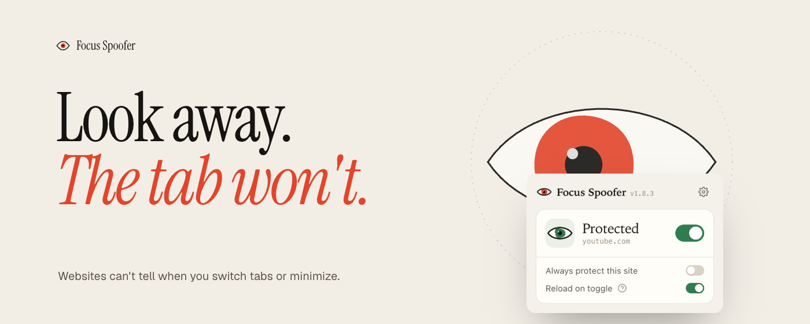
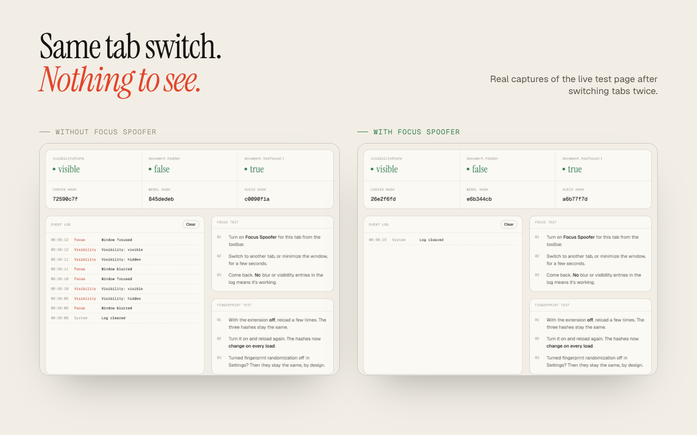
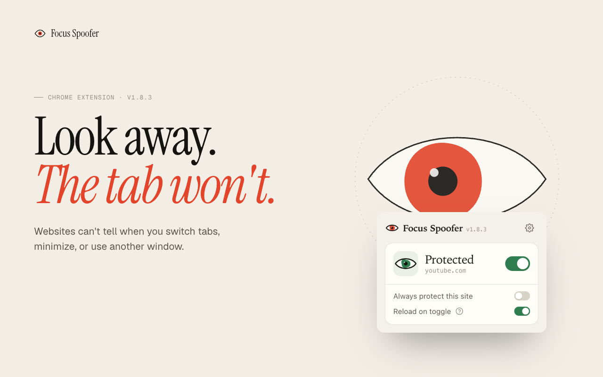

# Focus Spoofer

[](https://focus.oddworks.us)

[](https://chromewebstore.google.com/detail/ejgeaphjlcnmjgadkcljhchgbaiioihh)
[](https://chromewebstore.google.com/detail/ejgeaphjlcnmjgadkcljhchgbaiioihh)
[](https://chromewebstore.google.com/detail/ejgeaphjlcnmjgadkcljhchgbaiioihh/reviews)
[](https://github.com/Abhinav-ranish/Focus-Spoofer/actions/workflows/ci.yml)
[](LICENSE)

Chrome extension that stops websites from detecting when you switch tabs or minimize the window.

Video lessons that pause the moment you look at another tab, dashboards that stop updating in
the background, pages that nag "are you still there?". Focus Spoofer makes the page believe
it is always visible and focused, on the tabs you choose and nowhere else. It is free, has no
account, and is available in 16 languages.

**[Install from the Chrome Web Store](https://chromewebstore.google.com/detail/ejgeaphjlcnmjgadkcljhchgbaiioihh)**
· [Website](https://focus.oddworks.us)
· [Try the live detection test](https://focus.oddworks.us/test)
· [Privacy policy](https://focus.oddworks.us/privacy)



## Contents

- [Why Focus Spoofer](#why-focus-spoofer)
- [Features](#features)
- [Install](#install)
- [Usage](#usage)
- [FAQ and limitations](#faq-and-limitations)
- [How it works](#how-it-works)
- [Development](#development)
- [Getting help](#getting-help)
- [Contributing](#contributing)
- [License](#license)

## Why Focus Spoofer

Overriding `document.hidden` is the easy part, and many pages notice tab switches some other
way. Focus Spoofer covers the other ways too:

- **Prototype probes.** It patches the getters on `Document.prototype`, so code that reads them
  directly still sees "visible".
- **Timing tricks.** Background tabs throttle animation frames and timers. Pages can measure
  that to infer you left, so the extension keeps them ticking.
- **Normal pages keep working.** Only *window-level* focus events are blocked. Typing in
  forms, dropdown menus and hover effects behave exactly as they would without it.
- **Patches look native.** Patched functions still report `[native code]` to `toString()`
  checks.
- **Nothing leaves your browser.** No remote code, no browsing history collected, and
  anonymous usage counts are off unless you opt in.

## Features

- **Visibility spoofing.** `document.hidden` is always `false`; `document.visibilityState` is
  always `'visible'`.
- **Focus spoofing.** `document.hasFocus()` always returns `true`.
- **Event blocking.** `visibilitychange`, `pagehide`, and the `blur`/`focus`/`mouseleave`
  events that mean the window lost focus never reach the page.
- **Timing-detection defense.** `requestAnimationFrame`, `requestVideoFrameCallback` and
  timers keep a near-normal cadence while the tab is hidden.
- **Fingerprint randomization.** An invisible, per-page-load perturbation of canvas, WebGL and
  audio readback. It is stable within a page load, so canvas apps don't flicker. It can be
  turned off in Settings.
- **Per tab or always on.** Protect just the current tab, or list sites that are protected on
  every visit.

## Install

**Chrome Web Store (recommended):**
[Focus Spoofer](https://chromewebstore.google.com/detail/ejgeaphjlcnmjgadkcljhchgbaiioihh).
It also installs in Edge, Brave, Opera and other Chromium browsers.

**From source:**

```bash
git clone https://github.com/Abhinav-ranish/Focus-Spoofer.git
```

Then open `chrome://extensions`, turn on **Developer mode**, click **Load unpacked** and pick
the `extension/` folder.

## Usage

1. Open a page that pauses or reacts when you leave the tab.
2. Click the Focus Spoofer (eye) icon and turn the switch **on**. The toolbar badge shows `ON`.
3. Switch tabs or minimize the window. The page carries on as if you never left.



- **Per tab:** protection lasts until the tab closes.
- **Always protect this site** in the popup (or **Settings → Always-On Domains**) protects a
  site on every visit.
- **Reload on toggle** (on by default) reloads the page when you flip the switch, so
  protection starts before the page's own scripts run.

To confirm it works, open the [live detection test](https://focus.oddworks.us/test), turn
protection on, and switch away. Nothing should appear in the event log.

## FAQ and limitations

**Will it get me past exam proctoring or anti-cheat software?**
No, and that is out of scope. The extension does not hide itself, and proctoring tools use
signals it doesn't touch. Follow the rules of any exam, course or employer you are subject to.

**A site still notices when I leave.**
Reload the page with protection on first: the very first load after you open a new site can
run some of the page's scripts before protection starts. If it still notices, check which
signal fails on the [live test](https://focus.oddworks.us/test) and
[open a site report](https://github.com/Abhinav-ranish/Focus-Spoofer/issues/new?template=site_compat.yml).
Some sites check things the extension doesn't cover, such as `IntersectionObserver` or timing
measured on their server.

**A drawing app, editor or game looks wrong.**
Turn off **Settings → Fingerprint randomization**. Focus protection keeps working.

**Why does Chrome warn that it can "read your browsing history"?**
That warning comes from the `webNavigation` permission, which the extension uses to protect
frames as they load and to keep the toolbar badge accurate. Nothing about the pages you
visit is sent anywhere.

**Firefox or Safari?**
Not supported. The extension relies on Chrome's Manifest V3 main-world script registration.

**Pages it can't run on:** `chrome://` pages, the Chrome Web Store, PDFs in the built-in
viewer, and `file://` pages unless you enable "Allow access to file URLs".

The full list is in [docs/AUDIT.md](docs/AUDIT.md#known-limitations-documented-not-fixed).

## How it works

All spoofing lives in [`extension/spoofer.js`](extension/spoofer.js). It is registered in the
page's `MAIN` world at `document_start`, so it runs before any site script. Two small gates
decide whether it runs: [`inject.js`](extension/inject.js) for per-tab protection and
[`inject_always.js`](extension/inject_always.js) for Always-On sites. The design, the
detection techniques it defends against, and the trade-offs are in
[docs/ARCHITECTURE.md](docs/ARCHITECTURE.md).

| Path | What's there |
| --- | --- |
| [`extension/`](extension) | The extension (Manifest V3, plain JavaScript, no build step, no dependencies) |
| [`test/`](test) | Unit tests and real-browser end-to-end suites |
| [`scripts/`](scripts) | Lint, package build, and website translation scripts |
| [`server/`](server) | Optional Cloudflare Worker + D1 for opt-in usage counts and the uninstall survey |
| [`site-proxy/`](site-proxy) | Cloudflare Worker serving the website at focus.oddworks.us |
| [`webpage/`](webpage) | The static website, including the live detection test |
| [`store-assets/`](store-assets) | Chrome Web Store screenshots in every language, and their generator |
| [`i18n/`](i18n) | Website translations |
| [`docs/`](docs) | Architecture, testing, audit and deployment notes |

## Development

Requires Node.js 22.5 or newer (the SQL tests use `node:sqlite`). `npm install` only fetches
dev tooling; the extension itself has no dependencies.

```bash
npm install
npm run check      # lint + unit tests + dist/focus-spoofer-<version>.zip
npm run test:e2e   # real-browser regression suites
```

- [docs/TESTING.md](docs/TESTING.md): automated suites, browser setup, and the manual matrix
- [docs/AUDIT.md](docs/AUDIT.md): reliability audit and known limitations
- [docs/DEPLOY.md](docs/DEPLOY.md): backend, build and Chrome Web Store release

## Getting help

- **Bugs and sites that still detect you:**
  [GitHub issues](https://github.com/Abhinav-ranish/Focus-Spoofer/issues/new/choose)
- **Security problems:** report privately as described in [SECURITY.md](SECURITY.md)
- **Everything else:** the support tab on the
  [Chrome Web Store listing](https://chromewebstore.google.com/detail/ejgeaphjlcnmjgadkcljhchgbaiioihh/support)

## Contributing

Bug reports, site reports, translations and pull requests are welcome. See
[CONTRIBUTING.md](CONTRIBUTING.md) for setup and the few rules the code follows.

Maintained by [Abhinav Ranish](https://github.com/Abhinav-ranish).

## License

[Apache License 2.0](LICENSE)
